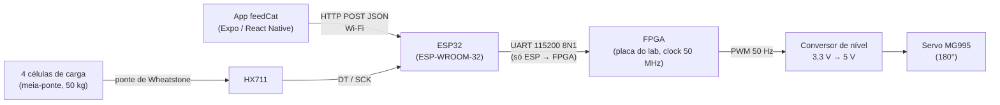
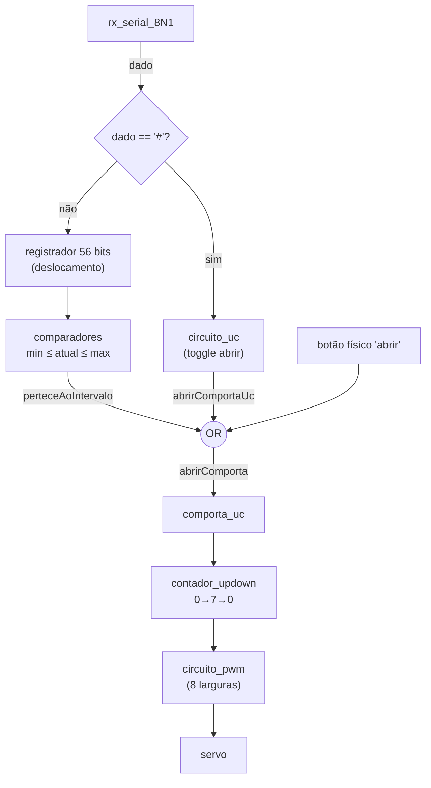

# 01 — Como era a implementação anterior (Feed Cat, Lab Digital II)

Fonte analisada: repositório `lab-digi-ii` (branch `main`, último commit `7d52400 semana 4`, 18/11/2024).
Código final do hardware em `projeto/semana3/Verilog/` (o commit "semana 4" alterou arquivos dessa pasta).
App em `projeto/app/feedCat/`.

> **Importante:** o firmware da ESP32 **não está no repositório** (nem no histórico do git — conferido com
> `git log --all`). Tudo o que está descrito sobre a ESP abaixo foi **deduzido** a partir do app, do Verilog,
> da especificação (`projeto/semana0/.../Semana0.1_T5BA5_Spec.pdf`) e de um diagrama de ligação que existiu no
> commit `ecc6122` (`projeto/feedCat/Imagens/celulas de carga com esp.png`, depois apagado).
> Recuperar esse firmware com o grupo anterior é a primeira ação recomendada (ver [06](06-decisoes-em-aberto.md)).

---

## 1. Objetivo do sistema

Comedouro para lares com dois gatos: uma balança identifica o gato pelo peso. Se o peso estiver entre
`peso_min` e `peso_max` (o gato magro), a porta do compartimento abre; caso contrário, fica fechada.
O usuário, pelo celular, configura os limites e pode abrir/fechar a porta para reabastecer.

## 2. Arquitetura

Observações:

- A especificação dizia que a **FPGA** leria o HX711, mas no Verilog final **não existe interface HX711**.
  O diagrama de ligação mostra o HX711 ligado **na ESP32** (DT/SCK em GPIO12/GPIO13, VCC em 5 V).
  Logo a ESP lê o peso e envia para a FPGA pela serial.
- A comunicação ESP → FPGA é **unidirecional**: a FPGA não tem transmissor serial instanciado em
  `circuito.v`. O app, portanto, **nunca recebe estado real** da porta ou do peso.

## 3. Componentes

| Componente | Função | Observação |
|---|---|---|
| ESP32 (ESP-WROOM-32, placa uPesy) | Wi-Fi, servidor HTTP, leitura HX711, UART para FPGA | Suporta Wi-Fi, BLE **e** Bluetooth Clássico |
| HX711 | ADC 24 bits das células | Alimentado em 5 V no diagrama (ver riscos em [02](02-revisao-implementacao.md)) |
| 4 células de carga 50 kg | Balança (ponte completa formada por 4 meias-pontes) | — |
| FPGA | Lógica de decisão (intervalo de peso) e geração do PWM | Displays 7 seg para debug |
| Conversor de nível | PWM 3,3 V → 5 V | — |
| Servo MG995 | Abre/fecha a porta (posicional, 180°) | Será trocado por servo 360° |

## 4. App (como está)

Arquivo principal: `projeto/app/feedCat/app/(tabs)/index.tsx`. Expo SDK 51, React Native 0.74, `expo-router`.

A tela tem 3 blocos, cada um faz um `fetch` HTTP para `http://${esp32Ip}` (padrão `192.168.4.1`, IP do
modo Access Point da ESP):

| Ação na tela | Requisição | Corpo | Tratamento da resposta |
|---|---|---|---|
| Enviar dados da balança | `POST /send-scale-data` | `{"minimumWeight":"1500","maximumWeight":"3000"}` (gramas, **como string**) | só olha `response.ok` |
| Enviar dados do Wi-Fi | `POST /receive-wifi` | `{"wifiSsid":"...","wifiPassword":"..."}` | espera `{"status":"connected","ip":"..."}` e troca `esp32Ip` |
| Abrir/Fechar porta | `POST /open-door` | `{"doorStatus":0 ou 1}` | se `ok`, inverte o estado **local** do botão |

Fluxo previsto (tela "Informações", `explore.tsx`):

1. ESP liga criando a rede **"Feed Cat"** (senha `12345678`).
2. Usuário conecta o celular nessa rede e envia SSID/senha da rede de casa.
3. ESP conecta na rede de casa e devolve o novo IP; o app passa a usar esse IP.
4. Isso precisa ser refeito **toda vez que a ESP é desligada** (credenciais não são salvas).

**Não existe nenhuma implementação Bluetooth no app** (nem dependência de BLE no `package.json`).

## 5. Protocolo serial ESP → FPGA (deduzido do Verilog)

Arquivo: `projeto/semana3/Verilog/circuito_fd.v`.

- UART 115200 bps, 8N1 (`rx_serial_8N1_nandland`, `CLKS_PER_BIT = 434` para 50 MHz).
- Cada byte recebido:
  - Se for `'#'` (0x23) → **comando**: alterna (toggle) a porta.
  - Senão → `valor = byte - '0'` é **deslocado** para dentro de um registrador de 56 bits
    (`D = {reg_out[47:0], valor}`).
- Mapeamento dos últimos 6 bytes recebidos (cada dígito ocupa 8 bits):

| Bytes (ordem de envio) | Bits | Significado (código) |
|---|---|---|
| 1º e 2º | `[47:32]` | `pesoMax` (dezena, unidade) |
| 3º e 4º | `[31:16]` | `pesoMin` |
| 5º e 6º | `[15:0]` | `pesoAtual` |

- Unidade: décimos de kg, 2 dígitos (00–99 ⇒ 0,0–9,9 kg). Ex.: max 3,0 kg, min 1,5 kg, atual 2,2 kg ⇒ ESP envia
  `"301522"`.
- Portanto a ESP precisa **reenviar os 6 dígitos a cada nova leitura de peso**, sempre com zero à esquerda e
  sem nenhum outro caractere (`\r`, `\n`, espaço…).

> ⚠️ O comentário no código diz `{comando, peso_min, peso_max, peso_atual}`, mas as atribuições usam
> `pesoMax = reg_out[47:32]` e `pesoMin = reg_out[31:16]` (**max antes de min**). E o testbench
> (`circuito_tb.v`) envia os dados com a intenção "min=10, max=20", o que na prática grava max=10 e min=20.
> Essa inconsistência é detalhada em [02](02-revisao-implementacao.md).

## 6. Hardware na FPGA (resumo)

- `circuito_uc.v`: estados `inicial → esperaDado → (armazenaDado | mudarPosicao) → esperaDado`.
- `comporta_uc.v`: `inicial → prepara → mudaPosicao ⇄ esperaIntervalo → esperaFechar → … → inicial`.
  A porta "anda" da posição 0 até 7 em passos de 20 ms (≈140 ms), fica em 7 enquanto `abrirComporta = 1` e
  depois volta de 7 até 0.
- `circuito_pwm.v`: período 1 000 000 ciclos (20 ms, 50 Hz). Larguras:

| Posição | Largura (ciclos) | Pulso |
|---|---|---|
| 000 (fechado) | 73 500 | 1,47 ms |
| 001 | 67 150 | 1,34 ms |
| 010 | 61 800 | 1,24 ms |
| 011 | 56 450 | 1,13 ms |
| 100 | 51 075 | 1,02 ms |
| 101 | 45 700 | 0,91 ms |
| 110 | 40 350 | 0,81 ms |
| 111 (aberto) | 35 000 | 0,70 ms |

- Displays: com `select_ucs = 0` mostram max/min/atual; com `select_ucs = 1` mostram estados das UCs e posição.
