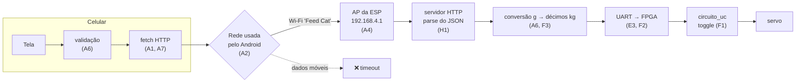

# 03 — "A ESP não recebe os dados enviados pelo app": por quê e o que fazer

## 1. Sintoma relatado

Os dados enviados pelo app (limites de peso, Wi-Fi, abrir porta) não chegam / não têm efeito na ESP.

Como o **firmware da ESP não está no repositório**, não dá para apontar a causa com certeza. O que dá para fazer é
seguir a mensagem por todo o caminho e listar onde ela pode se perder. Vários desses pontos são **defeitos
confirmados no código** que existe (app e FPGA); os outros são **hipóteses** que se testam em poucos minutos.

## 2. O caminho de uma mensagem



Códigos (A*, E*, F*) remetem à [revisão](02-revisao-implementacao.md).

## 3. Causas prováveis (ordenadas)

| # | Causa | Tipo | Como confirmar | Correção |
|---|---|---|---|---|
| 1 | **Android bloqueia HTTP cleartext em APK de produção** (A1) | confirmada no app, depende de como foi instalado | Rodar o mesmo app no Expo Go/dev build: se lá funciona e no APK não, é isso. No `adb logcat` aparece `CLEARTEXT communication ... not permitted` | `expo-build-properties` → `android.usesCleartextTraffic: true` (ou migrar para BLE) |
| 2 | **Celular manda o tráfego pelos dados móveis** porque o AP não tem internet (A2) | hipótese muito comum | Desligar dados móveis e repetir. Se passar a funcionar, é isso | Instruir o usuário / forçar a rede (lib nativa) / **BLE** |
| 3 | **Erro na leitura do corpo JSON na ESP** (H1) | hipótese (firmware) | `curl` do notebook conectado ao AP (ver §4). Log serial do que a ESP recebeu | Ver H1 abaixo |
| 4 | **IP errado depois de configurar o Wi-Fi** (A3, A4) | confirmada no app | Após enviar Wi-Fi, conferir no monitor serial o IP da ESP e comparar com o que o app usa | Salvar IP; descoberta; ou BLE |
| 5 | **Dado chega na ESP mas se perde na FPGA** (F1, F2, F3, E3) | confirmada no Verilog | Displays da FPGA com `select_ucs=0` mostram max/min/atual: se aparecer lixo ou trocado, é aqui | Protocolo com quadro + flip-flop no toggle |
| 6 | Erro de ponto flutuante / `NaN` no valor (A6) | confirmada no app | Enviar `2,01` e ver o que a ESP imprime | Enviar inteiro em gramas |

### H1 — Leitura do JSON no servidor da ESP

O app manda `Content-Type: application/json` com o JSON no **corpo**. Depende da biblioteca usada:

| Biblioteca | Jeito que **não** funciona com esse app | Jeito que funciona |
|---|---|---|
| `WebServer.h` (síncrona, do core) | `server.arg("minimumWeight")` (só lê query/form) | `server.arg("plain")` + `deserializeJson` |
| `ESPAsyncWebServer` | `request->getParam("minimumWeight", true)` (só `x-www-form-urlencoded`) | `AsyncCallbackJsonWebHandler` ou `onBody` |

Esse é um dos erros mais comuns em projetos ESP32 + app: o handler é chamado (a rota "responde"), mas os campos vêm
vazios. Também: `minimumWeight` chega como **string** (`"1500"`), então `doc["minimumWeight"].as<int>()` pode dar 0
dependendo da versão do ArduinoJson.

Outro caso: a rota `/receive-wifi` chamando `WiFi.begin()` e esperando conectar **antes** de responder. O `fetch`
fica pendurado, e quando a ESP entra na rede de casa (mudando de canal) o AP derruba o celular — a resposta nunca
chega.

## 4. Roteiro de diagnóstico (≈30 min, sem mudar código)

Isola cada camada, da ponta da ESP para trás:

1. **ESP sozinha** — notebook conectado na rede "Feed Cat", monitor serial aberto:
   ```bash
   curl -v -X POST http://192.168.4.1/send-scale-data \
        -H "Content-Type: application/json" \
        -d '{"minimumWeight":"1500","maximumWeight":"3000"}'
   ```
   - Não responde → problema de rede/servidor na ESP.
   - Responde mas o serial mostra campos vazios → **H1**.
   - Funciona → a ESP está ok; o problema está no celular (passo 2) ou na FPGA (passo 4).
2. **Celular, dados móveis desligados**, app no Expo Go → se funciona, a causa era **A2**.
3. **Mesmo teste no APK instalado** → se falha só aqui, a causa é **A1**.
4. **ESP → FPGA** — mandar pelo monitor serial/`Serial2` a string `301522` e olhar os displays da FPGA
   (`select_ucs = 0` ⇒ `30 15 22`). Mandar `#` várias vezes e ver se a porta alterna **sempre** (se às vezes não,
   é **F1**).

Registrar os resultados em [06-decisoes-em-aberto.md](06-decisoes-em-aberto.md).

## 5. Solução proposta

### 5.1 Princípios

1. **Comandos explícitos, nunca toggle.** `ABRIR`/`FECHAR`, não "inverte".
2. **Todo comando tem resposta** (ack/erro) e **o dispositivo publica o estado real** (peso, porta, fim de curso).
   O app mostra o que o dispositivo diz, não o que ele acha.
3. **Mensagens com enquadramento e validação** em todos os enlaces (BLE/HTTP e UART).
4. **Unidades inteiras e explícitas** (gramas, milissegundos).
5. **Configuração persistente** na ESP (NVS/`Preferences`) — sobrevive a quedas de energia.

### 5.2 Quem decide o quê (app × dispositivo)

A ideia do grupo de "deixar o app com algumas decisões" é boa, desde que o app **decida a política** e o
dispositivo **execute e garanta a segurança**. O celular pode sair de alcance, travar ou ficar sem bateria — se a
decisão de fechar a porta dependesse do app, a porta poderia ficar aberta para o gato errado ou fechar em cima do
gato.

| Decisão | Onde | Motivo |
|---|---|---|
| Faixas de peso de cada pet, nomes, perfis | **App** (envia config) | é política, muda raramente |
| Horários/janelas de alimentação, porções | **App** (envia config) | idem |
| Tempo de confirmação, histerese, tempo para fechar | **App** (envia config, com limites validados na ESP) | ajuste fino do usuário |
| Abrir para reabastecer | **App** (comando) com **auto-fechamento** na ESP após N min | se o app sumir, a porta não fica aberta |
| Tara / calibração da balança | **App** inicia, **ESP** executa | precisa de interação do usuário |
| Abrir/fechar a cada leitura de peso | **Dispositivo** | tempo real, precisa funcionar offline |
| Parar o servo no fim de curso, timeout, anti-esmagamento | **Dispositivo** (idealmente também em hardware) | segurança |
| Histórico, gráficos, alertas ("gato gordo tentou comer 5x") | **App** a partir dos eventos enviados | não é crítico |

Se o grupo quiser um modo em que o **app comanda a porta em tempo real** (ex.: demonstração), usar **concessão com
prazo (lease)**: o app manda `ABRIR por 10 s` e renova periodicamente; se parar de renovar, a ESP fecha sozinha.

### 5.3 Protocolo de aplicação (independe do transporte)

Mesmo formato para BLE agora e Wi-Fi depois. JSON curto (fácil de depurar) com um campo de tipo e um id para casar
resposta com pedido:

```jsonc
// App → ESP
{"t":"cfg","id":7,"minG":1500,"maxG":3000,"confMs":2000,"closeMs":4000}
{"t":"cmd","id":8,"op":"open_refill","timeoutS":300}
{"t":"cmd","id":9,"op":"close"}
{"t":"cmd","id":10,"op":"tare"}

// ESP → App
{"t":"ack","id":7,"ok":true}
{"t":"ack","id":8,"ok":false,"err":"door_fault"}
{"t":"st","wG":2210,"door":"open","fcOpen":1,"fcClosed":0,"mode":"auto"}   // periódico e em mudanças
{"t":"ev","ev":"door_opened","by":"weight","wG":2210}
```

Estados da porta publicados: `closed`, `opening`, `open`, `closing`, `fault`.

### 5.4 ~~Enlace ESP ↔ FPGA~~ (descartado — projeto novo não usa FPGA, ver [07](07-comunicacao-app-esp32.md))

Trocar o registrador de deslocamento por quadros fixos, e **incluir o caminho de volta** FPGA → ESP (a FPGA já tem
`tx_serial_8N1_nandland.v` no repositório):

```
ESP → FPGA   < C MMMM NNNN AAAA K >     C = 'W' pesos | 'O' abrir | 'F' fechar
                                         MMMM/NNNN/AAAA = gramas/10 em 4 dígitos (até 99,99 kg)
                                         K = checksum: 'A' + (soma dos bytes entre < e K) % 26
                                             (sempre uma letra, nunca colide com '<' ou '>')
FPGA → ESP   < S P X Y K >              P = estado da porta, X/Y = fins de curso
```

Com `Serial2` dedicada e terra comum. Se a FPGA sair do projeto (ver [06](06-decisoes-em-aberto.md)), este item
desaparece e a lógica vai para uma *task* na ESP.

### 5.5 Correções mínimas se quiserem manter o Wi-Fi/HTTP por enquanto

1. `expo-build-properties` com `usesCleartextTraffic: true` (Android) e exceção ATS/rede local (iOS).
2. Mostrar erro em todos os `catch`; `AbortController` com timeout.
3. Rota `/status` (GET) e botão "Atualizar"; porta com `open`/`close` explícitos.
4. Responder `/receive-wifi` **antes** de trocar de rede; salvar credenciais em NVS; mostrar o IP no display ou
   anunciar via mDNS (`feedcat.local`) — lembrando que resolução `.local` no Android é irregular.
5. Enviar pesos como inteiro em gramas.

Mas, dado que a próxima etapa é Bluetooth, a recomendação é **não investir no fluxo AP/HTTP** e ir direto para o BLE
(ver [04](04-app-bluetooth.md)): ele elimina as causas 1, 2 e 4 de uma vez.
