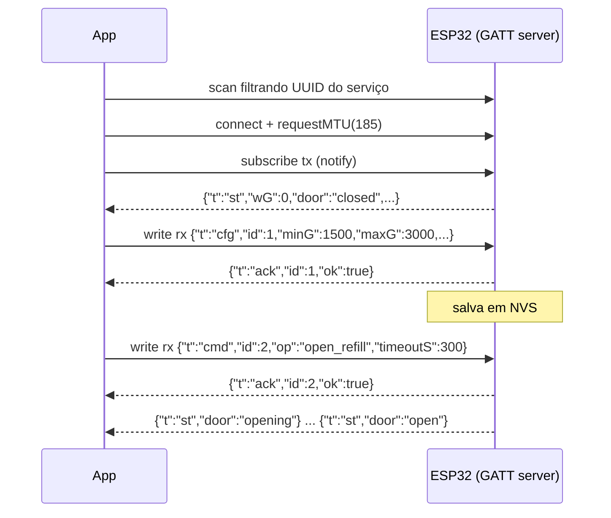

# 04 — App: Bluetooth antes do Wi-Fi

## 1. Como está hoje

**Não há Bluetooth na implementação anterior.** O app (`projeto/app/feedCat/app/(tabs)/index.tsx`) só fala
HTTP sobre Wi-Fi, primeiro com a ESP em modo *Access Point* (`192.168.4.1`) e depois, em tese, na rede de casa
(detalhes em [01](01-implementacao-anterior.md) §4). O `package.json` não tem nenhuma biblioteca de BLE e o
`app.json` não declara permissões de Bluetooth.

A ESP usada (ESP-WROOM-32) tem **BLE e Bluetooth Clássico**, então não é preciso trocar hardware.

## 2. Por que começar pelo Bluetooth

| Problema do fluxo Wi-Fi atual | Com BLE |
|---|---|
| Cleartext HTTP bloqueado no APK (A1) | não existe HTTP |
| Android usa dados móveis porque o AP não tem internet (A2) | não depende de rede IP |
| Descobrir/guardar IP da ESP (A4) | o app procura o dispositivo pelo UUID do serviço |
| Reconfigurar Wi-Fi a cada queda de energia | não precisa de Wi-Fi |
| Estado da porta não chega ao app (A5) | *notify* empurra o estado para o app |

Limitação: só funciona **perto** do comedouro (~10 m). Controle remoto fica para a fase Wi-Fi — e o próprio BLE
pode servir para **provisionar** o Wi-Fi depois (fase 2).

## 3. BLE ou Bluetooth Clássico (SPP)?

| | **BLE (recomendado)** | Clássico / SPP |
|---|---|---|
| Android | ✅ | ✅ |
| iOS | ✅ | ❌ (iOS não abre SPP para apps comuns) |
| Lib no app | `react-native-ble-plx` | `react-native-bluetooth-classic` |
| Lado ESP | `NimBLE-Arduino` (leve) ou BLE do core | `BluetoothSerial` — parece uma `Serial`, muito simples |
| Modelo | Serviço + características (*read/write/notify*) | fluxo de bytes |
| Consumo / coexistência com Wi-Fi | melhor | pior; Wi-Fi + BT Clássico + BLE juntos pesam na RAM/flash |
| Funciona em ESP32-S3/C3 (se trocarem de placa) | ✅ | ❌ |

**Recomendação: BLE.** SPP só compensa se todos os celulares do grupo forem Android e o objetivo for uma demo
rápida (o protocolo em linhas de texto é idêntico ao da serial).

## 4. Desenho do serviço GATT

Um serviço próprio com três características. O conteúdo das mensagens é o mesmo protocolo JSON proposto em
[03](03-problema-comunicacao-app-esp.md) §5.3, então trocar BLE por Wi-Fi depois muda só o transporte.

| Nome | UUID (exemplo, gerado para o projeto) | Propriedades | Conteúdo |
|---|---|---|---|
| Serviço Feed Cat | `82f60cca-ca15-4989-a008-e281f6de445f` | — | — |
| `rx` (app → ESP) | `848af807-807a-4c97-99f8-cc571600aaa7` | Write | `{"t":"cfg",...}`, `{"t":"cmd",...}` |
| `tx` (ESP → app) | `c486e549-7967-47aa-bed6-ee5ac21e1890` | Notify, Read | `{"t":"ack",...}`, `{"t":"st",...}`, `{"t":"ev",...}` |

Alternativa mais "BLE-idiomática": uma característica por dado (`peso` notify, `porta` notify, `config`
read/write, `comando` write). É mais eficiente, mas o par `rx`/`tx` com JSON é mais fácil de depurar e de
reaproveitar no Wi-Fi. Para o laboratório, `rx`/`tx` é suficiente.



### Detalhes que costumam dar problema

- **MTU:** o padrão do BLE permite só **20 bytes** por escrita/notificação. As mensagens JSON acima têm 60–90 bytes.
  No Android, pedir MTU maior logo após conectar (`requestMTUForDevice(id, 185)`); no iOS a negociação é
  automática. Na ESP, configurar MTU máximo. Se preferir não depender disso, usar binário compacto.
- **Uma mensagem por escrita.** Não fragmentar JSON em várias escritas sem um delimitador.
- **Escrita com resposta** (`writeWithResponse`) para comandos — garante entrega no nível do enlace; o `ack` do
  protocolo garante que a ESP **aceitou**.
- **Reconexão:** ao desconectar, a ESP precisa voltar a anunciar (`startAdvertising` no callback de desconexão).
  Esquecer isso é o bug nº 1 de BLE em ESP32: conecta a primeira vez, nunca mais.
- **Callbacks BLE não devem fazer trabalho pesado** (mexer no servo, gravar NVS). Enfileirar a mensagem e processar
  na *task* principal.
- **Segurança (opcional para o lab):** exigir *bonding* com PIN fixo para escrita em `rx`.

## 5. Lado ESP32 (esboço)

Biblioteca sugerida: **NimBLE-Arduino** (h2zero). Esboço — os nomes exatos variam entre versões da lib:

```cpp
// esboço ilustrativo, não é código final
NimBLEServer* srv = NimBLEDevice::createServer();
NimBLEService* svc = srv->createService(SVC_UUID);
NimBLECharacteristic* rx = svc->createCharacteristic(RX_UUID, NIMBLE_PROPERTY::WRITE);
NimBLECharacteristic* tx = svc->createCharacteristic(TX_UUID, NIMBLE_PROPERTY::READ | NIMBLE_PROPERTY::NOTIFY);

class RxCallbacks : public NimBLECharacteristicCallbacks {
  void onWrite(NimBLECharacteristic* c /*, connInfo */) {
    xQueueSend(filaMensagens, c->getValue().c_str(), 0);   // só enfileira
  }
};
class SrvCallbacks : public NimBLEServerCallbacks {
  void onDisconnect(/* ... */) { NimBLEDevice::startAdvertising(); }  // não esquecer
};

// loop / task principal:
//   - consome filaMensagens → valida → aplica (config em Preferences, comando na máquina da porta) → tx->notify(ack)
//   - a cada 500 ms ou em mudança: tx->setValue(statusJson); tx->notify();
```

**Para testar antes do app existir:** app **nRF Connect** (Android/iOS) — conecta, escreve em `rx` e mostra as
notificações de `tx`. Assim firmware e app podem ser feitos em paralelo.

## 6. Lado app (Expo / React Native)

### 6.1 Pré-requisitos

- **BLE não roda no Expo Go.** É preciso um *development build* (`npx expo run:android` ou
  `eas build --profile development`). O `eas.json` já tem o perfil `development` com `developmentClient: true`.
- Biblioteca: `react-native-ble-plx` (tem plugin de configuração para Expo), mais um utilitário de base64
  (a lib troca valores em base64).
- Atualizar o projeto para um SDK atual do Expo antes de adicionar libs nativas (SDK 51 é de 2024).
- Permissões:
  - Android 12+: `BLUETOOTH_SCAN`, `BLUETOOTH_CONNECT` (pedir em tempo de execução);
  - Android ≤ 11: `ACCESS_FINE_LOCATION` para escanear;
  - iOS: `NSBluetoothAlwaysUsageDescription` no `Info.plist` (via `app.json`).

### 6.2 Estrutura sugerida

Separar **transporte** de **protocolo** para a troca BLE → Wi-Fi ser local:

```
src/
  device/
    protocol.ts        // tipos das mensagens (cfg, cmd, ack, st, ev), encode/decode, validação
    DeviceLink.ts      // interface: connect(), send(msg): Promise<Ack>, onStatus(cb), disconnect()
    BleLink.ts         // implementação com react-native-ble-plx
    WifiLink.ts        // fase 2 (WebSocket/HTTP), mesma interface
  state/
    useDevice.ts       // hook: estado de conexão, último status, envio com timeout + id
  screens/
    Conectar.tsx       // scan / lista / conectar
    Painel.tsx         // peso ao vivo, estado real da porta, abrir p/ reabastecer, fechar
    Configuracao.tsx   // faixas de peso, tempos, tara/calibração
```

Esboço do envio com confirmação:

```ts
// esboço ilustrativo
async function send(msg: Omit<AppMsg, 'id'>, timeoutMs = 3000): Promise<Ack> {
  const id = nextId++;
  const json = JSON.stringify({ ...msg, id });
  const ackPromise = waitFor(m => m.t === 'ack' && m.id === id, timeoutMs); // rejeita no timeout
  await device.writeCharacteristicWithResponseForService(SVC_UUID, RX_UUID, toBase64(json));
  return ackPromise;
}
```

### 6.3 Mudanças de UX em relação ao app atual

- Botão da porta **reflete o estado publicado pela ESP** (`closed/opening/open/closing/fault`), não um toggle local.
- Peso atual ao vivo na tela (útil para o usuário escolher as faixas e para a apresentação).
- Pesos digitados em kg, enviados como **inteiro em gramas**; validação com `Number.isFinite`.
- Toda falha vira mensagem visível (sem `catch { return; }`).
- Tela de conexão com estado claro: "procurando…", "conectado a Feed Cat", "desconectado — tentar de novo".

## 7. Roteiro

| Fase | Entrega | Critério de pronto |
|---|---|---|
| 1a | Firmware: GATT `rx`/`tx`, status periódico com peso do HX711 | nRF Connect mostra notificações e aceita `cfg` com `ack` |
| 1b | App: dev build, scan/conexão, painel com peso ao vivo | peso muda na tela ao apertar a balança |
| 1c | Comandos de porta + config persistente | desliga/liga a ESP e a config continua; porta segue o app com estado real |
| 2 | Provisionamento de Wi-Fi via BLE (`{"t":"wifi","ssid":..,"pass":..}`) + `WifiLink` | app controla fora do alcance do BLE |
