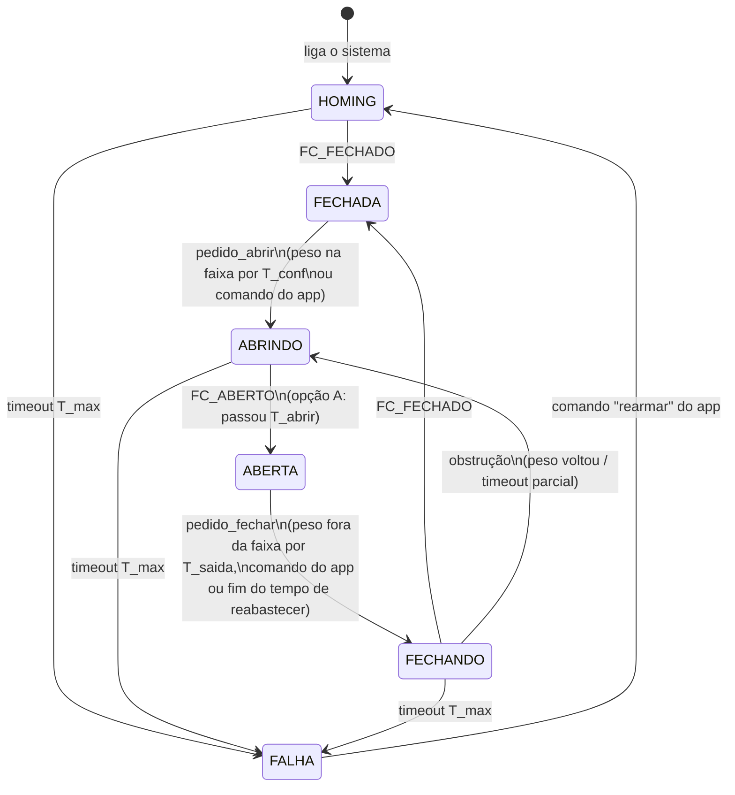

# 05 — Servo 360° com chave de fim de curso

## 1. O que muda de um servo comum para um de 360°

| | Servo posicional (MG995 180°, projeto anterior) | Servo de rotação contínua (360°) |
|---|---|---|
| O pulso PWM define… | a **posição** do eixo | a **velocidade e o sentido** |
| ~1,5 ms | meio do curso | **parado** (ponto neutro, ajustável por trimpot em muitos modelos) |
| < 1,5 ms | gira para um lado e **para** no ângulo | gira **continuamente** num sentido (mais rápido quanto mais longe de 1,5 ms) |
| > 1,5 ms | gira para o outro lado e para | gira continuamente no outro sentido |
| Sabe onde está? | sim (potenciômetro interno) | **não** — por isso a chave de fim de curso |

## 2. Por que a lógica atual não serve

A FPGA gera 8 larguras de pulso, todas **entre 0,70 ms e 1,47 ms** (`circuito_pwm.v`), e a `comporta_uc` faz a
rampa 0→7 para abrir e 7→0 para fechar. Com um servo 360°:

- posição 0 (1,47 ms) ≈ parado (talvez andando devagar, dependendo do neutro);
- posições 1 a 7 = girando **sempre no mesmo sentido**, cada vez mais rápido;
- no estado `esperaFechar` o pulso fica em 0,70 ms → **o motor gira sem parar enquanto a porta estiver "aberta"**;
- para "fechar", a rampa volta a 1,47 ms → o motor desacelera **no mesmo sentido**, nunca inverte.

Ou seja: com o servo 360° a porta não fecha e o mecanismo é forçado. A lógica precisa ser trocada, não ajustada.

## 3. Novo modelo: 3 comandos + sensores

O servo passa a ter só três "comandos":

| Comando | Pulso típico | Observação |
|---|---|---|
| `PARAR` | 1,50 ms **ou** sem pulso (linha em 0) | ver §5 |
| `ABRIR` | ex.: 1,30 ms | sentido e velocidade a calibrar; mais perto de 1,5 ms = mais lento e mais seguro |
| `FECHAR` | ex.: 1,70 ms | idem, sentido oposto |

E quem diz "chegou" é a **chave de fim de curso**, com um **tempo máximo** como proteção.

### 3.1 Quantas chaves?

O grupo mencionou **uma** chave. Funciona, mas vale conhecer as opções:

| Opção | Como funciona | Prós | Contras |
|---|---|---|---|
| **A. Uma chave, no FECHADO** (mínimo) | Fecha até a chave atuar. Abre girando por um **tempo calibrado** `T_abrir`. Ao ligar o sistema faz *homing* (fecha até a chave) | 1 sensor; a posição de referência (fechado) é "zerada" a cada ciclo | a posição "aberta" varia com bateria/atrito/carga; se `T_abrir` for demais força o batente |
| **B. Duas chaves (FECHADO e ABERTO)** (recomendado) | Abre até FC_ABERTO; fecha até FC_FECHADO | posição exata nos dois extremos; detecta falha nos dois sentidos | 1 chave e 1 GPIO a mais |
| C. Uma chave no ABERTO | simétrico à A | — | a posição de referência vira a aberta; **não** recomendado (o estado seguro é fechado) |

**Recomendação:** projetar a maquete para **duas chaves** (opção B). Se só houver uma, colocá-la no **FECHADO**
(opção A) — o estado seguro é porta fechada e é ele que precisa de precisão.

## 4. Máquina de estados da porta

Vale igual para firmware na ESP ou para uma nova `comporta_uc` em Verilog.



Saídas por estado:

| Estado | Servo | Observação |
|---|---|---|
| `HOMING`, `FECHANDO` | `FECHAR` | só enquanto `FC_FECHADO = 0` |
| `ABRINDO` | `ABRIR` | só enquanto `FC_ABERTO = 0` |
| `FECHADA`, `ABERTA`, `FALHA` | `PARAR` | — |

Regras importantes:

1. **O fim de curso tem prioridade sobre qualquer estado.** Mesmo que a FSM "erre", se `FECHAR` estiver ativo e
   `FC_FECHADO = 1`, o servo recebe `PARAR` (ver intertravamento, §6).
2. **Timeout sempre.** Chave quebrada, fio solto ou porta travada não podem deixar o motor girando para sempre.
   `T_max` ≈ 2× o tempo medido de abertura.
3. **Anti-esmagamento:** durante `FECHANDO`, se o peso voltar para a faixa do gato magro (ele voltou a comer), volta a
   `ABRINDO`. Fechar só depois de `T_saida` segundos sem gato.
4. Na opção A, `ABERTA` sem chave: se a porta pode ser empurrada à mão, a posição real diverge — o próximo
   `FECHANDO` corrige, pois fecha até a chave.

## 5. "Desligar" o servo

Três níveis, do mais simples ao mais robusto:

| Forma | Como | Cuidado |
|---|---|---|
| Pulso neutro | 1,5 ms contínuo | servo 360° barato "anda devagar" se o neutro não estiver calibrado (trimpot); temperatura muda o neutro |
| **Parar de mandar pulsos** | saída PWM fica em 0 | na maioria dos servos a eletrônica desliga o motor sem pulso; **testar no modelo comprado** |
| Cortar alimentação | MOSFET canal P / módulo relé no +V do servo | desliga de verdade; reduz ruído elétrico na leitura do HX711; mais um componente |

Sugestão: **parar os pulsos** no software e, se sobrar tempo/verba, **MOSFET cortando o +V** quando parado.
Medir o consumo parado para decidir.

## 6. Ligação elétrica

```
            3V3
             │
            [R 10k]  (ou pull-up interno)
             │
 GPIO ───────┼──────[R 1k]──┐          ESP32: GPIO com pull-up interno
             │              │          (evitar 34–39: não têm pull-up;
            [C 100nF]     ┌─┴─┐        evitar 0, 2, 5, 12, 15: strapping)
             │            │ FC│  contato NC
            GND           └─┬─┘
                            GND
```

- **Usar contato NC (normalmente fechado) ligado ao GND, com pull-up.**
  - Porta longe do batente: NC fechado → GPIO = 0.
  - Chave acionada: contato abre → GPIO = 1 → "chegou".
  - **Fio rompido** → GPIO = 1 → o sistema entende "chegou" e **para o motor**. Falha segura.
- RC (1 kΩ + 100 nF) filtra ruído do motor; somar **debounce em software** de 10–20 ms.
- Nível lógico: pull-up para **3,3 V**, nunca 5 V (vale para ESP32 e para os GPIO da FPGA).
- Mecânica: chave com **alavanca de roldana**, montada para atuar **um pouco antes** do batente físico (o motor
  tem inércia e a parada leva até 1 período de PWM = 20 ms).

### Alimentação do servo

- MG995/MG996R 360° pode puxar **mais de 1 A** ao arrancar ou travar. **Fonte 5–6 V separada**, não o pino 5V da
  placa/USB. **GND comum** com a ESP/FPGA.
- Capacitor eletrolítico grande (470–1000 µF) perto do servo.
- Picos do motor aparecem na leitura do HX711: **não usar leituras de peso enquanto o motor gira**, ou filtrar.
- Sinal PWM: muitos servos aceitam 3,3 V; o conversor de nível do projeto anterior pode ser mantido.

### Intertravamento (mesmo que a FSM tenha um bug, o motor não passa do batente)

Na ESP32, fazer a checagem **no ponto onde o pulso é escrito**, e não só nas transições da FSM:

```cpp
// chamada a cada ciclo da tarefa Porta, logo antes de atualizar o PWM
int pulsoSeguro(Comando cmd, bool fcAberto, bool fcFechado) {
  if (cmd == ABRIR  && !fcAberto)  return PULSO_ABRIR;
  if (cmd == FECHAR && !fcFechado) return PULSO_FECHAR;
  return 0;  // sem pulso = parado
}
```

Um intertravamento puramente elétrico é possível (cortar a alimentação do servo por um transistor comandado pela
chave), mas com o servo 360° isso também impediria sair do batente no sentido oposto. Por isso a checagem em
software, junto com o timeout, é o suficiente para o laboratório.

## 7. Impacto no código

### Na ESP32 (decisão do grupo — ver [07](07-comunicacao-app-esp32.md) §5)

- PWM com `LEDC` (50 Hz, 16 bits) ou biblioteca `ESP32Servo` usando `writeMicroseconds()`.
- Chaves em GPIO com `INPUT_PULLUP`; ler por *polling* a cada 5 ms com debounce (mais simples e previsível que
  interrupção com ruído de motor).
- FSM da §4 numa *task* própria (FreeRTOS), separada do BLE. O BLE só **enfileira** pedidos.
- Parâmetros (`T_conf`, `T_saida`, `T_max`, pulsos de abrir/fechar) vêm da config do app e ficam em NVS.

### ~~Se a FPGA continuar~~ (descartado — mantido só como referência do projeto antigo)

Arquivos do projeto anterior que deixam de servir / mudam:

| Arquivo | O que fazer |
|---|---|
| `servo/contador_updown.v`, `mux_8x1_n` da posição | remover (não há mais rampa de posição) |
| `servo/circuito_pwm.v` | reduzir para 3 larguras (`PARAR`, `ABRIR`, `FECHAR`) + `enable` |
| `comporta_uc.v` | reescrever com a FSM da §4 (entradas `fc_aberto`, `fc_fechado`, `timeout`) |
| `contador_m` | reutilizar para `T_max`, `T_conf`, `T_saida` e debounce |
| `edge_detector.v` | reutilizar para detectar borda das chaves |
| novo: sincronizador + debounce das chaves | 2 flip-flops + contador de ~10 ms |
| `tx_serial_8N1_nandland.v` | instanciar para devolver estado da porta/chaves à ESP |

## 8. Calibração (fazer com a maquete pronta)

1. Achar o neutro: variar o pulso de 1,40 a 1,60 ms em passos de 0,01 ms e anotar a faixa em que o motor fica parado
   (ou ajustar o trimpot com 1,50 ms).
2. Escolher pulsos de abrir/fechar que deem movimento firme mas não violento (ex.: neutro ± 0,2 ms).
3. Medir tempo de abertura e fechamento (10 repetições). `T_max` = 2 × maior tempo.
4. Opção A (uma chave): `T_abrir` = tempo médio de abertura × 0,9 e verificar se a porta libera a comida.
5. Testar falhas: soltar o fio da chave (deve parar), travar a porta com a mão (deve ir para `FALHA` no timeout),
   colocar peso durante o fechamento (deve reabrir).
