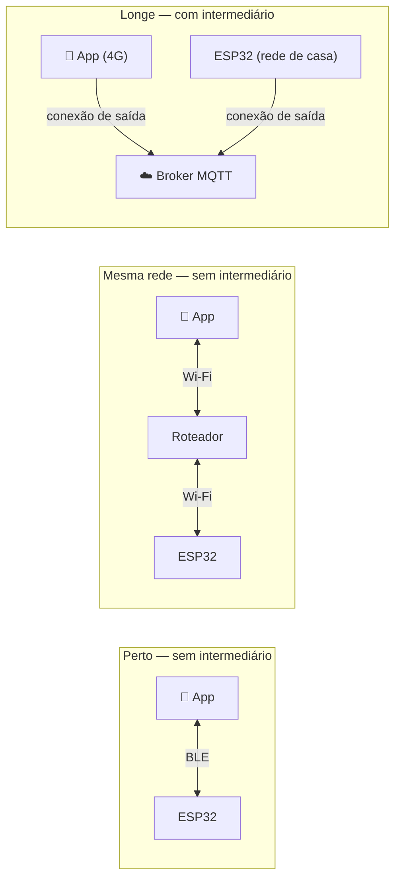
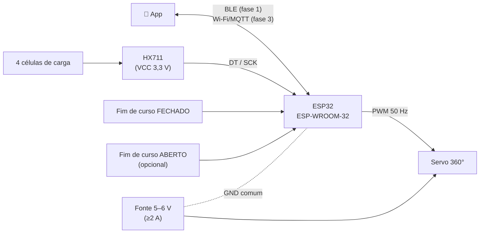
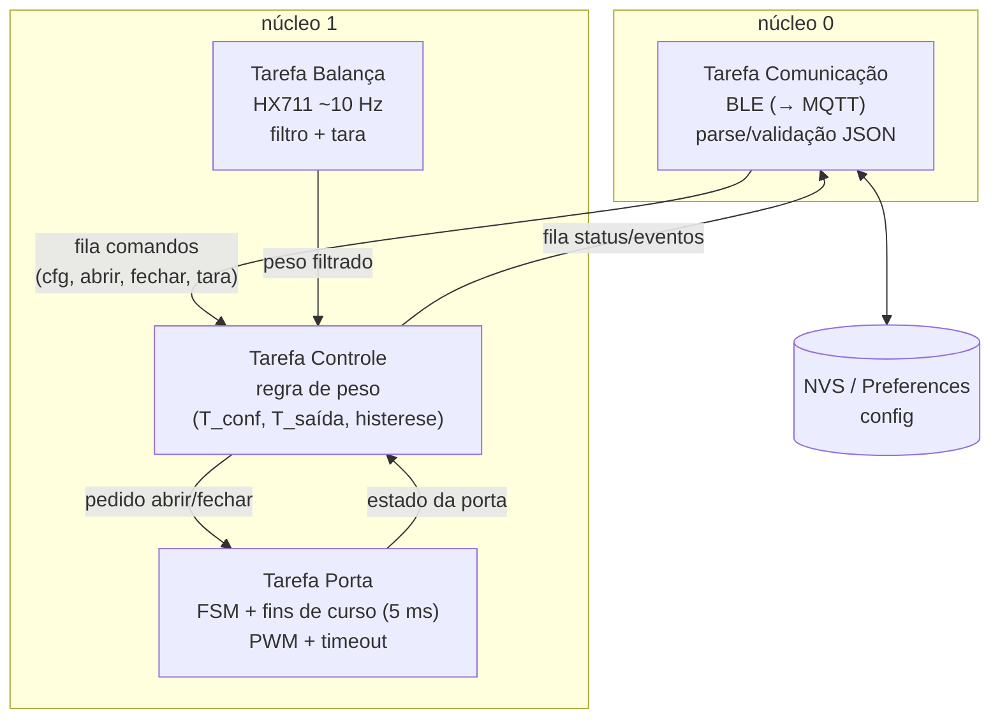
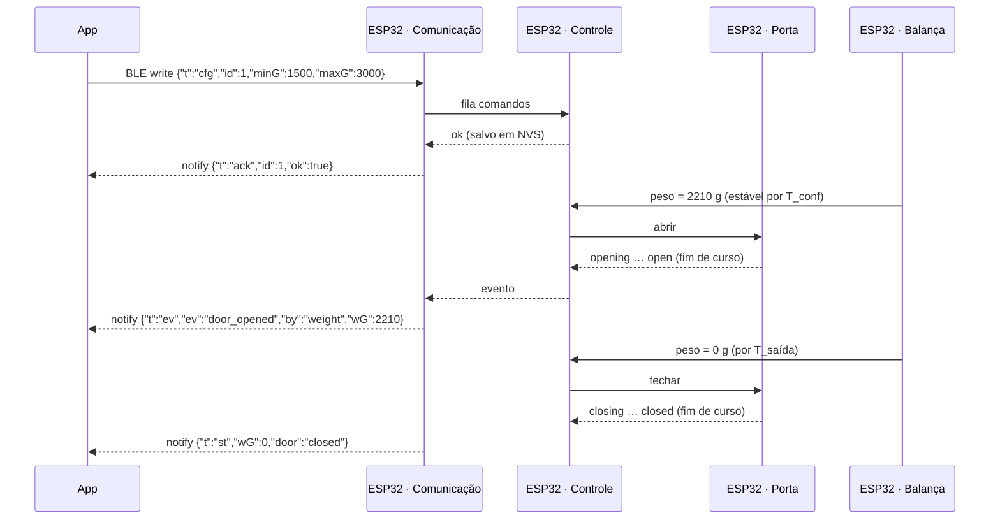

# 07 — Comunicação app ↔ ESP32 (arquitetura sem FPGA)

**Decisão do grupo:** a FPGA sai do projeto. A ESP32 lê a balança, decide, move o servo, lê as chaves de fim de
curso e conversa com o app.

---

## 1. É possível? Precisa de intermediário?

**É possível, e na maioria dos casos não precisa de intermediário.** A ESP32 tem rádio **Wi-Fi** e **Bluetooth (BLE)**
no próprio chip, então o celular pode falar diretamente com ela.

A necessidade de intermediário depende só de **onde o celular está** em relação ao comedouro:

| Onde está o celular | Transporte | Intermediário? | Por quê |
|---|---|---|---|
| Perto (mesmo cômodo, ~10 m) | **BLE** | **Não** | celular ↔ ESP32 direto, rádio a rádio |
| Na mesma rede Wi-Fi de casa | Wi-Fi local (WebSocket/HTTP) | **Não** (o roteador só encaminha pacotes) | ambos estão na mesma rede e se enxergam por IP |
| Longe (rua, 4G, outra rede) | Wi-Fi + internet | **Sim**: um *broker*/servidor na nuvem | o roteador de casa (NAT) não deixa ninguém de fora abrir conexão com a ESP32 |

No caso "longe", o truque é que **os dois lados abrem conexão para fora**, até o broker. Nenhum precisa aceitar
conexão de entrada, então o NAT do roteador não atrapalha.

## 2. Como fazer o *send* **e** o *receive* (ida e volta)

O projeto anterior usava HTTP, que é só **pergunta → resposta**: o app pergunta e a ESP responde, mas **a ESP
nunca consegue avisar o app por conta própria**. Por isso o app não sabia se a porta abriu. Para ter ida e volta de
verdade:

| Transporte | App → ESP (*send*) | ESP → App (*receive*) | Observação |
|---|---|---|---|
| **BLE** | escrita na característica `rx` | **notificação** na característica `tx` | nativo, bidirecional |
| **WebSocket** (Wi-Fi local) | `ws.send(json)` | `ws.onmessage` | conexão aberta nos dois sentidos |
| **MQTT** (via broker) | publica em `feedcat/<id>/cmd` | assina `feedcat/<id>/status` | *publish/subscribe* |
| HTTP (projeto antigo) | `POST` | ❌ só na resposta; para ver mudanças o app tem que ficar perguntando (*polling*) | não recomendado |

O **conteúdo** das mensagens é o mesmo em todos os transportes: o JSON de [03](03-problema-comunicacao-app-esp.md)
§5.3 (`cfg`, `cmd` → `ack`, `st`, `ev`). Trocar BLE por Wi-Fi depois muda só a "camada de baixo".

## 3. Recomendação por fases

| Fase | Transporte | Intermediário | O que entrega |
|---|---|---|---|
| **1 (agora)** | **BLE** | nenhum | configurar faixas, abrir para reabastecer, ver peso e estado da porta ao vivo |
| 2 | BLE para **passar SSID/senha** do Wi-Fi para a ESP (substitui o antigo AP "Feed Cat") | nenhum | ESP entra na rede de casa sem o fluxo problemático do AP |
| 3 (opcional) | **MQTT** sobre Wi-Fi | broker (ex.: HiveMQ Cloud, EMQX Cloud — ambos têm plano gratuito — ou Mosquitto num PC/Raspberry) | controle de qualquer lugar; o app nem precisa descobrir o IP da ESP |

Por que MQTT e não WebSocket local na fase 3: com o broker, o app **não precisa descobrir o IP** da ESP (problema A4
do projeto antigo) e o mesmo caminho funciona dentro e fora de casa. WebSocket local é mais simples, mas exige
descoberta de IP e só funciona na mesma rede.

Cuidados na fase 3: usar **TLS e usuário/senha** no broker. Broker público de teste (sem senha) serve só para
demonstração, porque qualquer um que souber o tópico abre a porta.

## 4. Nova arquitetura de hardware

### Pinagem sugerida (ESP-WROOM-32)

| Função | GPIO | Motivo |
|---|---|---|
| HX711 DT | 26 | não é pino de *strapping* (o projeto antigo usava o 12, que atrapalha o boot) |
| HX711 SCK | 25 | idem |
| Servo PWM | 13 | saída comum, LEDC, não é pino de *strapping* (a primeira sugestão era o 18) |
| Fim de curso FECHADO | 32 | tem pull-up interno |
| Fim de curso ABERTO | 33 | tem pull-up interno |
| LED de estado | 2 | LED da própria placa |

Evitar: 0, 2 (como entrada), 5, 12, 15 (*strapping*); 6–11 (flash); 34–39 como entrada de chave (sem pull-up
interno). Conferir com o *pinout* da placa uPesy antes de montar.

## 5. Arquitetura do firmware

Sem FPGA, **toda a lógica que estava no Verilog vira firmware**. Sugestão com tarefas do FreeRTOS (já vem na
ESP32, inclusive no Arduino):

| Tarefa | Faz | Substitui (projeto antigo) |
|---|---|---|
| Comunicação | recebe mensagens do app, valida, responde `ack`, envia `st`/`ev` | servidor HTTP + UART ESP→FPGA |
| Balança | lê HX711, média móvel, ignora leituras com motor girando | leitura HX711 (já era na ESP) |
| Controle | "gato certo na balança por `T_conf` → abrir; fora por `T_saída` → fechar"; reabastecer com auto-fechamento | comparadores + `circuito_uc` |
| Porta | FSM de [05](05-servo-360-fim-de-curso.md) §4, prioridade do fim de curso, timeout | `comporta_uc` + `circuito_pwm` |

Regras simples que evitam os bugs de concorrência mais comuns:

- **Callback do BLE só enfileira** a mensagem. Quem mexe no servo é a tarefa Porta.
- Tarefas trocam dados por **filas** (`xQueueSend`/`xQueueReceive`), não por variáveis globais soltas.
- A config vive em NVS e é carregada no boot. O app nunca é necessário para o comedouro funcionar.

### Bibliotecas (Arduino / PlatformIO)

| Função | Biblioteca |
|---|---|
| BLE | `NimBLE-Arduino` (mais leve que o BLE padrão, importante para rodar junto com Wi-Fi) |
| Balança | `HX711` (bogde) ou `HX711_ADC` |
| Servo | `ESP32Servo` (`writeMicroseconds`) ou LEDC direto |
| JSON | `ArduinoJson` |
| Config | `Preferences` (NVS, já vem no core) |
| MQTT (fase 3) | `PubSubClient` + `WiFiClientSecure`, ou `esp-mqtt` |

BLE + Wi-Fi + TLS juntos podem não caber na partição padrão de 1,3 MB. Se o upload reclamar de tamanho, trocar o
esquema de partição (ex.: "Huge APP" / `board_build.partitions = huge_app.csv` no PlatformIO).

## 6. Fluxo completo (fase 1)

Se o app estiver desconectado, tudo acima acontece igual. As notificações simplesmente não são enviadas, e ao
reconectar o app recebe o `st` atual.

## 7. O que isso resolve da revisão

| Problema ([02](02-revisao-implementacao.md)) | Situação |
|---|---|
| F1–F8 (Verilog), E3 (UART ESP→FPGA) | **eliminados**: não há mais FPGA nem enlace serial |
| A1 (cleartext HTTP), A2 (dados móveis), A4 (IP) | **eliminados na fase 1** (BLE); na fase 3 o MQTT dispensa IP |
| A5 (estado da porta falso) | resolvido com `notify`/`status` vindos da ESP |
| E1 (HX711 em 5 V), E2 (GPIO12) | resolvidos com a nova pinagem e HX711 em 3,3 V |
| A3, A6, A7 (erros, validação, timeout) | continuam valendo para o **novo app** |
