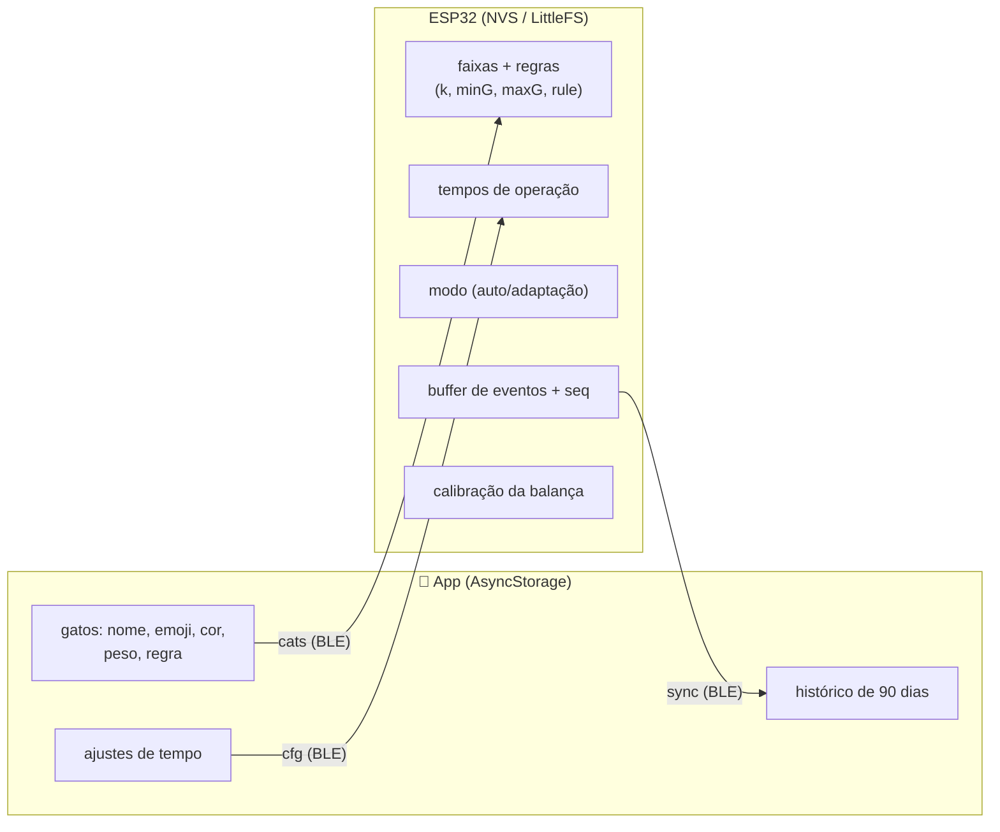

# 08 — Persistência: o que fica no celular e o que fica na ESP32

Pergunta que motivou este documento: **com o cadastro de gatos, onde esses dados vivem?**

---

## 1. Como era antes (projeto do Lab Digital II)

**Nada era guardado.** Em nenhuma das três partes:

| Onde | O que acontecia ao desligar |
|---|---|
| App | `useState` puro: fechou o app, perdeu os limites de peso e o IP da ESP |
| ESP32 | sem NVS (a própria tela de ajuda dizia: *"Isso deverá ser feito toda vez que você desconectar o dispositivo da tomada"*) |
| FPGA | os pesos viviam num registrador de deslocamento de 56 bits — some no reset |

Ou seja: **cada queda de energia exigia reconfigurar tudo pelo celular**, e o comedouro ficava inútil
(sem limites válidos) até alguém abrir o app. Para um aparelho que fica ligado na tomada num canto da casa, isso é
um defeito grave, não um detalhe.

## 2. O princípio agora

> O comedouro tem que funcionar **sozinho**, por tempo indeterminado, sem celular por perto.

Disso sai tudo o mais: **a ESP32 precisa guardar em flash tudo o que ela usa para decidir**. O celular guarda o que
é do usuário (nomes, histórico longo), não o que é da decisão.



## 3. O que o app guarda (já implementado)

Arquivo: `app/src/data/storage.ts`. Hoje usa **AsyncStorage** (que no navegador vira `localStorage`).

| Chave | Conteúdo | Quem escreve |
|---|---|---|
| `feedcat.cats.v1` | os 2 gatos: nome, emoji, cor, peso, tolerância, regra | `catsStore.saveCat` |
| `feedcat.events.v1` | histórico de visitas (90 dias) + `lastSeq` sincronizado | `eventsStore.ingest` |
| `feedcat.settings.v1` | tempos de confirmação, espera e reabastecimento | `deviceStore.setSettings` |

Apagar tudo: aba **Comedouro → Apagar dados do app** (`catsStore.resetAll`).

Quando o histórico crescer, a troca para SQLite mexe só em `storage.ts` — as telas não sabem onde os dados moram.

## 4. O que a ESP32 vai guardar

### 4.1 Configuração — NVS (`Preferences`)

Pequena, muda raramente, precisa sobreviver a quedas de energia:

| Dado | Tamanho | Por que na ESP |
|---|---|---|
| Faixas e regras dos gatos (`k`, `minG`, `maxG`, `rule`) | ~16 bytes | é o que decide abrir ou não |
| Tempos (`confMs`, `leaveMs`, `maxOpenS`) | 12 bytes | comportamento da porta |
| Modo (`auto` / `learn`) | 1 byte | o modo adaptação dura dias |
| Calibração da balança (fator de escala e tara) | 8 bytes | sem isso o peso sai errado no boot |
| `seq` do último evento | 4 bytes | os números não podem repetir depois de um reset |
| Versão da configuração (`cfgV`) | 2 bytes | evita regravar NVS a cada conexão |

**O que NÃO vai para a ESP:** nome, emoji e cor dos gatos. O dispositivo trabalha com `k = 1` e `k = 2`; quem sabe
que o gato 1 se chama Mimi é o app. Isso economiza flash e deixa renomear um gato sem escrever na ESP.

**O que NÃO é persistido de propósito:** as **liberações temporárias** ("Bolota por 15 min"). Elas dependem do
relógio, e a ESP32 perde a hora ao desligar — o certo, ao voltar, é o gato em dieta continuar bloqueado. Liberação
perdida é chato; liberação fantasma é um gato comendo escondido.

### 4.2 Histórico — buffer circular

Eventos são muitos e descartáveis depois de sincronizados:

- **200 a 300 eventos** num buffer circular (LittleFS, ou um *blob* em NVS);
- cada evento tem `seq` crescente, que **nunca reinicia**;
- o app pede `{"t":"sync","since":<último seq que ele tem>}` e recebe só o que falta;
- se o buffer encher antes de alguém conectar, os mais antigos se perdem. Com ~10 visitas/dia e 200 posições, isso
  dá cerca de **20 dias** de folga — suficiente.

### 4.3 Modo adaptação: um histograma também persistido

O modo adaptação roda por dias e pode gerar mais visitas do que o buffer aguenta. Para não depender disso, a ESP
mantém em NVS um **histograma de pesos**: 64 faixas de 250 g (0 a 16 kg), 2 bytes cada = **128 bytes**.

Cada visita incrementa uma posição. Mesmo que o buffer de eventos gire, o histograma preserva a distribuição — e é
tudo o que a identificação precisa (o agrupamento em `app/src/domain/learning.ts` trabalha bem com contagens por
faixa). Também é barato de enviar por BLE.

### 4.4 Desgaste da flash

NVS aguenta na casa de **100 mil ciclos de escrita** por setor, com desgaste distribuído. Regras para não estourar:

- **nunca** persistir o peso instantâneo (chega a cada 500 ms — seriam 172 mil escritas por dia);
- gravar configuração só quando ela **muda de verdade** (comparar `cfgV`);
- eventos: uma escrita por visita (~10/dia) é irrelevante;
- histograma: uma escrita por visita, ou acumular em RAM e gravar a cada N visitas.

## 4.5 Cópia de segurança do cadastro no próprio comedouro (implementado)

Fechar o app **não** perde nada: o AsyncStorage sobrevive a fechar, reiniciar o celular e atualizar o app. Some
apenas quando o usuário **desinstala**, **limpa os dados do app**, **troca de celular** ou (na versão web) limpa os
dados do site.

Para esses casos, o comedouro guarda também um **texto opaco** com o que só o app entende — nomes, emoji e cores:

```jsonc
// app -> ESP: o dispositivo não interpreta, só guarda e devolve
{"t":"profile","id":9,"blob":"[{\"id\":1,\"name\":\"Mimi\",\"emoji\":\"🐱\",\"color\":\"laranja\"}]"}

// app -> ESP: celular novo pergunta o que o comedouro sabe
{"t":"cfgGet","id":10}

// ESP -> app
{"t":"cfgDump","cats":[{"k":1,"minG":2700,"maxG":3700,"rule":"allow"}],
 "confMs":2000,"leaveMs":4000,"maxOpenS":300,"mode":"auto","cfgV":7,
 "profile":"[{\"id\":1,\"name\":\"Mimi\",\"emoji\":\"🐱\",\"color\":\"laranja\"}]"}
```

São cerca de **60 a 120 bytes** de flash para os dois gatos — barato, e evita o pior caso (usuário reinstalar o app
e ter que redescobrir o peso dos gatos).

Quando o app abre sem nenhum gato salvo, ele **pergunta ao comedouro antes de pedir ao usuário**
(`catsStore.recoverFromDevice`). Só cai na tela de boas-vindas se o dispositivo também não souber de nada.

O que **não** volta nesse caminho: o **histórico antigo**. O comedouro só tem o buffer dos últimos eventos; o
histórico longo vive no celular. Para não perder isso, as opções estão na §7.

## 5. Quem manda quando os dois discordam

**O app é a fonte da verdade da configuração**; a ESP é a fonte da verdade do histórico e do estado da porta.

Na conexão:

1. app envia `hello` com a hora atual;
2. app compara o `cfgV` que veio no `st` com o que ele tem; se for diferente, reenvia `cats` e `cfg`;
3. app pede `sync` a partir do último `seq` que tem guardado.

Isso resolve os dois casos chatos:

- **usuário trocou de celular / reinstalou o app:** resolvido pelo `cfgGet` + `profile` da §4.5 — o novo app
  recupera faixas, regras, nomes, emoji e cores.
- **ESP trocada / resetada:** ela volta sem gatos; o app percebe pelo `cfgV` zerado e reenvia tudo.

## 6. O que ainda pode ser perdido

| Situação | Perde? | Por quê |
|---|---|---|
| Fechar o app | **Não** | os dados ficam gravados no aparelho |
| Reiniciar o celular, atualizar o app | **Não** | idem |
| Ficar dias sem abrir o app | **Não** | o comedouro guarda os eventos e sincroniza depois |
| Desligar o comedouro da tomada | **Não** (config) | NVS guarda faixas, regras, tempos, modo e calibração |
| Desinstalar o app / trocar de celular | **Config não, histórico sim** | o cadastro volta pelo `cfgGet`; o histórico longo era só do celular |
| Ficar mais de ~20 dias sem conectar | Eventos mais antigos | o buffer circular do comedouro gira |
| Liberação temporária + queda de energia | Sim, de propósito | sem relógio, o seguro é o gato em dieta continuar bloqueado |

## 7. Backup do histórico: precisa de banco na nuvem?

**Ainda não.** A ordem de resolver, do mais barato ao mais caro:

| # | Solução | Resolve | Custo |
|---|---|---|---|
| 1 | Local + cópia do cadastro no comedouro (**feito**) | tudo menos histórico longo em celular novo | zero |
| 2 | **Exportar/importar** o histórico num arquivo JSON | backup manual, passar para outro celular | pequeno, sem servidor |
| 3 | Banco na nuvem (Supabase, Firebase) | backup automático, vários celulares, acesso remoto | precisa de internet, conta, autenticação e cuidado com dados |

Quando fizer sentido ir para o 3: quando a família quiser **dois celulares** vendo o mesmo histórico, ou acesso de
fora de casa. Nesse caso o caminho natural é a fase 3 de [07](07-comunicacao-app-esp32.md): a ESP publica os
eventos num broker MQTT e um serviço (Supabase, por exemplo) assina e grava. O app passa a ler do banco quando
está longe e do BLE quando está perto.

Enquanto o projeto for da disciplina, o item 2 dá o mesmo resultado prático com muito menos peça para dar errado.

## 8. Pendências

| # | Pendência | Onde |
|---|---|---|
| 1 | Implementar NVS, buffer de eventos e histograma na ESP32 | firmware (Etapa 2/3) |
| 2 | Decidir o tamanho do buffer com o consumo real medido | firmware |
| 3 | Exportar/importar histórico em arquivo (item 2 da §7) | app |
| 4 | Migrar o histórico do app para SQLite quando passar de alguns milhares de eventos | `app/src/data/` |
