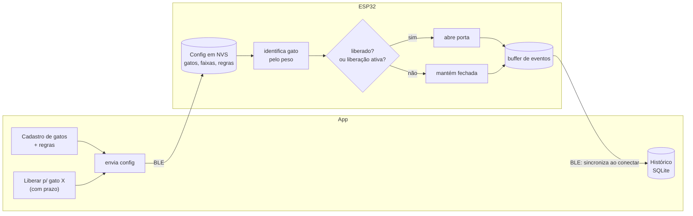

# Plano — Novo app Feed Cat

Status: **Etapas 0 e 1 implementadas** (app em `../app`) · Criado em 16/09/2026 · Atualizado em 18/09/2026

---

## 1. Estamos usando React Native?

**Sim.** O app antigo (`lab-digi-ii/projeto/app/feedCat`) é **React Native com Expo** (TypeScript + `expo-router`).
A proposta é **continuar em React Native + Expo**, mas num **projeto novo** dentro deste repositório
(`labEmbarcados/app/`), no SDK atual do Expo (hoje o **SDK 57**). O repo antigo fica só como referência.

Por que projeto novo e não atualizar o antigo:

- o antigo tem **uma tela** de lógica e o resto é template do Expo;
- está no SDK 51 (2024); pular 6 versões de SDK dá mais trabalho que recomeçar;
- o Expo Go atual só abre projetos no SDK mais recente;
- a arquitetura muda toda: sai HTTP, entra BLE com estado vindo do dispositivo.

## 2. Como o app está hoje (inventário)

| Item | Situação atual |
|---|---|
| Framework | Expo SDK 51, React Native 0.74, React 18.2, TypeScript, `expo-router` 3.5 |
| Telas | `Home` (formulários) e `Informações` (textos de ajuda) em abas |
| Conexão com a ESP | **só `fetch` HTTP** para `http://192.168.4.1` (modo AP) ou o IP devolvido depois |
| Métodos | `handleSubmitScaleData` → `POST /send-scale-data` · `handleSubmitWiFi` → `POST /receive-wifi` · `handleOpenDoor` → `POST /open-door` |
| Bluetooth | **nenhum** (sem lib, sem permissões) |
| Recebe dados da ESP? | **não**: só lê `response.ok` (e o IP no caso do Wi-Fi) |
| Persistência | **nenhuma**: tudo em `useState`, perde ao fechar o app |
| Estado da porta | toggle local, não reflete a porta real |
| Visual | fundo escuro fixo, `TextInput` + `Button` padrão, sem identidade visual |
| Build | `eas.json` com perfis `development` / `preview` / `production` |

Detalhes e bugs: [docs/02](../docs/02-revisao-implementacao.md) (A1–A9).

## 3. O que o novo app vai fazer

### 3.1 Funcionalidades

| # | Funcionalidade | Descrição | Prioridade |
|---|---|---|---|
| F1 | **Conectar ao comedouro** | procurar via BLE, conectar, reconectar sozinho, mostrar estado da conexão | Alta |
| F2 | **Cadastro de gatos** | nome, foto/emoji, **peso** (kg) e tolerância; o app calcula a faixa (ex.: 3,2 kg ± 0,3) | Alta |
| F3 | **Regra de acesso por gato** | `Liberado` (pode comer) · `Bloqueado` (dieta) · *(futuro)* horários | Alta |
| F4 | **Painel ao vivo** | peso atual na balança, quem o comedouro reconheceu, estado **real** da porta | Alta |
| F5 | **Histórico de visitas** | quando a balança foi ativada, **qual gato**, quanto tempo ficou, se a porta **abriu** (comeu) ou foi **negada** | Alta |
| F6 | **Liberar para um gato bloqueado** | ex.: "liberar o Bolota **por 15 min**" ou "**na próxima visita**"; a ESP abre quando ele subir e a liberação expira sozinha | Alta |
| F7 | **Abrir para reabastecer** | abre a porta com fechamento automático após N min, com contagem regressiva na tela | Alta |
| F8 | **Balança** | tara (zerar), calibração com peso conhecido, visualização da leitura bruta | Média |
| F9 | **Ajustes de comportamento** | tempo de confirmação, tempo para fechar, tempo máximo de abertura | Média |
| F10 | **Resumo do dia** | visitas por gato, quantas negadas, gráfico por hora | Média |
| F11 | **Visitante desconhecido** | peso fora de todas as faixas vira "desconhecido" no histórico | Média |
| F12 | Modo simulação | dispositivo falso para desenvolver e apresentar sem a maquete | Alta (dev) |
| F14 | **Modo adaptação/identificação** | porta fica aberta por alguns dias (os gatos aprendem que ali tem comida) enquanto a balança registra o peso de cada visita; depois o app separa as medições em dois grupos e o usuário só dá nome a cada um. O modo manual continua disponível | Alta |
| F13 | Wi-Fi / acesso remoto | fase futura ([docs/07](../docs/07-comunicacao-app-esp32.md) §3) | Baixa |

> **"Quem comeu"**: com o hardware atual (uma balança onde o gato sobe), o sistema sabe **quem visitou e se a
> porta abriu**, não **quanto** comeu. Medir consumo exigiria pesar o pote (outra célula de carga + HX711).
> Fica como melhoria opcional (§9).

### 3.2 Onde cada decisão fica

Segue a divisão de [docs/03](../docs/03-problema-comunicacao-app-esp.md) §5.2: **o app define as regras, a ESP32
aplica em tempo real**, mesmo sem celular por perto.



Pontos importantes:

- A ESP guarda **os gatos cadastrados** (id, faixa, regra). Assim identifica e decide sozinha.
- A ESP guarda os **eventos num buffer circular** (ex.: últimos 200, em flash). O app **sincroniza** quando
  conecta, porque o BLE não fica conectado o tempo todo.
- A ESP32 **não tem relógio**: ao conectar, o app envia a hora atual. Eventos ocorridos antes de receber a hora
  são gravados com o tempo desde o boot e corrigidos na sincronização.
- Faixas de dois gatos **não podem se sobrepor**; o app valida no cadastro.

## 4. Telas

Navegação por abas embaixo: **Início · Gatos · Histórico · Comedouro**.

```
┌──────────────────────────┐  ┌──────────────────────────┐  ┌──────────────────────────┐
│ Feed Cat        ● Conect.│  │ Gatos                  + │  │ Histórico      Hoje ▾    │
│                          │  │                          │  │                          │
│  ┌────────────────────┐  │  │ ┌──────────────────────┐ │  │ 14:32  🐱 Mimi           │
│  │  🐱 Mimi na balança│  │  │ │ 🐱 Mimi       3,2 kg │ │  │        porta aberta · 4m │
│  │      3,24 kg       │  │  │ │ faixa 2,9–3,5  ✅ Lib.│ │  │ 13:10  🐈 Bolota         │
│  │  Porta: ABERTA 🟢  │  │  │ └──────────────────────┘ │  │        negado · 40s   🔒 │
│  └────────────────────┘  │  │ ┌──────────────────────┐ │  │ 12:55  ❓ Desconhecido   │
│                          │  │ │ 🐈 Bolota     6,5 kg │ │  │        1,1 kg · 5s       │
│  Hoje                    │  │ │ faixa 6,0–7,0  🔒 Dieta│ │  │ 09:02  🐱 Mimi           │
│  Mimi   ███████  5 vis.  │  │ │ [ Liberar por 15 min ]│ │  │        porta aberta · 6m │
│  Bolota ██ 2 negadas     │  │ └──────────────────────┘ │  │                          │
│                          │  │                          │  │  ▁▃▅▂▁▇▃ visitas/hora    │
│ [🔓 Liberar Bolota     ] │  │                          │  │                          │
│ [🥣 Abrir p/ reabastecer]│  │                          │  │                          │
├──────────────────────────┤  ├──────────────────────────┤  ├──────────────────────────┤
│ 🏠   🐱   🕘   ⚙️        │  │ 🏠   🐱   🕘   ⚙️        │  │ 🏠   🐱   🕘   ⚙️        │
└──────────────────────────┘  └──────────────────────────┘  └──────────────────────────┘
```

| Tela | Conteúdo |
|---|---|
| **Início** | cartão ao vivo (peso, gato reconhecido, porta), resumo do dia, ações rápidas (liberar gato, reabastecer), aviso de liberação ativa com contagem regressiva |
| **Gatos** | lista em cartões; criar/editar (nome, emoji/foto, peso, tolerância, regra); botão "liberar" nos bloqueados; opção "usar peso atual da balança" ao cadastrar |
| **Histórico** | lista de visitas agrupada por dia, filtro por gato, gráfico simples por hora |
| **Comedouro** | conexão (procurar/esquecer), estado da porta e fins de curso, tara/calibração, tempos, sobre/ajuda |
| **Primeiro uso** | boas-vindas → permissões de Bluetooth → procurar comedouro → cadastrar o primeiro gato |

Diretrizes visuais:

- mobile-first, **botões grandes** (≥ 48 px), cartões arredondados, ícones e emojis de gato para ficar simpático;
- **tema claro e escuro** seguindo o sistema;
- cores com significado fixo: verde = aberto/liberado, cinza = fechado, âmbar = liberação temporária,
  vermelho = falha;
- toda ação mostra **carregando → confirmado / erro** (nunca "silêncio");
- textos em português, números no formato brasileiro (`3,24 kg`).

## 5. Stack proposta

| Camada | Escolha | Motivo |
|---|---|---|
| Base | **Expo SDK 57** + React Native + TypeScript | continuidade com o app antigo, build fácil com EAS |
| Navegação | `expo-router` (abas + pilhas) | já usado no app antigo |
| Bluetooth | `react-native-ble-plx` 3.x | BLE maduro, tem plugin para Expo; exige *development build* |
| Estado global | `zustand` | simples, pouco código |
| Histórico / dados locais | `expo-sqlite` | consultas por data/gato para histórico e gráficos |
| Estilo | `StyleSheet` com *tokens* de tema (cores, espaçamentos) — **ou** NativeWind (Tailwind) | decidir em §10 |
| Gráficos | `react-native-gifted-charts` (+ `react-native-svg`) | barras simples, fácil |
| Ícones | `@expo/vector-icons` | já vem no Expo |
| Animações | `react-native-reanimated` | já vem no template |
| Testes | `jest-expo` para protocolo e regras (validação de faixas, parse de mensagens) | a lógica crítica é testável sem celular |

Observação: **BLE não roda no Expo Go**. Para desenvolver a interface usamos o **modo simulação** (F12), que roda no
Expo Go; para testar com a ESP usamos um *development build* no celular Android (`eas build --profile development`
ou `npx expo run:android`).

## 6. Arquitetura do código

```
labEmbarcados/app/
  app/                          # rotas (expo-router)
    _layout.tsx
    onboarding/...
    (tabs)/
      index.tsx                 # Início
      gatos/index.tsx, [id].tsx
      historico.tsx
      comedouro.tsx
  src/
    device/
      protocol.ts               # tipos + encode/decode + validação das mensagens
      DeviceLink.ts             # interface comum
      BleLink.ts                # implementação real (react-native-ble-plx)
      MockLink.ts               # simulador: gatos "subindo" na balança, porta abrindo
    store/
      deviceStore.ts            # conexão, status ao vivo, envio com ack/timeout
      catsStore.ts              # gatos cadastrados (espelho do que foi enviado à ESP)
    db/
      schema.ts, events.ts      # SQLite: eventos, sincronização por número de sequência
    domain/
      ranges.ts                 # faixa a partir do peso, checagem de sobreposição
      format.ts                 # kg, horários, durações em pt-BR
    ui/
      theme.ts                  # cores, espaçamentos, tipografia (claro/escuro)
      components/               # Card, BigButton, StatusPill, CatAvatar, WeightDisplay...
```

Regra principal: **as telas nunca falam com o BLE diretamente**, só com os *stores*. Os stores usam
`DeviceLink`, que pode ser `BleLink` ou `MockLink`. Trocar para Wi-Fi no futuro = criar `WifiLink`.

## 7. Protocolo app ↔ ESP32 (versão 2)

Amplia o protocolo de [docs/03](../docs/03-problema-comunicacao-app-esp.md) §5.3 com gatos, liberações e histórico.
Transporte: BLE, características `rx` (app → ESP) e `tx` (ESP → app), ver [docs/04](../docs/04-app-bluetooth.md) §4.

```jsonc
// ── App → ESP ────────────────────────────────────────────────
{"t":"hello","id":1,"v":2,"now":1789574400}             // versão do protocolo + hora atual (epoch s)
{"t":"cats","id":2,"cats":[                              // lista completa (substitui a anterior)
  {"k":1,"minG":2900,"maxG":3500,"rule":"allow"},
  {"k":2,"minG":6000,"maxG":7000,"rule":"deny"}]}
{"t":"grant","id":3,"cat":2,"untilS":1789575300}         // liberar gato 2 até o horário
{"t":"grant","id":4,"cat":2,"visits":1}                  // liberar gato 2 na próxima visita
{"t":"revoke","id":5,"cat":2}
{"t":"cmd","id":6,"op":"refill","timeoutS":300}          // abrir p/ reabastecer
{"t":"cmd","id":7,"op":"close"}
{"t":"cmd","id":8,"op":"tare"}
{"t":"cmd","id":9,"op":"calibrate","refG":1000}
{"t":"cfg","id":10,"confMs":2000,"leaveMs":4000,"maxOpenS":900}
{"t":"mode","id":11,"mode":"learn"}                      // 'learn' = adaptação (abre para qualquer gato, só medindo) | 'auto'
{"t":"profile","id":13,"blob":"[{\"id\":1,\"name\":\"Mimi\",\"emoji\":\"🐱\"}]"}  // cópia de segurança dos nomes
{"t":"cfgGet","id":14}                                   // celular novo pergunta o que o comedouro guarda
{"t":"sync","id":12,"since":120}                         // pede eventos com seq > 120

// ── ESP → App ────────────────────────────────────────────────
{"t":"ack","id":2,"ok":true}
{"t":"ack","id":3,"ok":false,"err":"unknown_cat"}
{"t":"st","wG":3240,"cat":1,"door":"open","fcC":0,"fcO":1,"grant":null,"mode":"auto"}
{"t":"ev","seq":121,"ts":1789574460,"kind":"visit","cat":1,"wG":3240,"durS":240,"door":"opened","why":"rule"}
{"t":"ev","seq":122,"ts":1789574900,"kind":"visit","cat":2,"wG":6480,"durS":40,"door":"denied","why":"rule"}
{"t":"ev","seq":123,"ts":1789575000,"kind":"visit","cat":0,"wG":1100,"durS":5,"door":"denied","why":"unknown"}
{"t":"ev","seq":126,"ts":1789575300,"kind":"visit","cat":0,"wG":3210,"durS":95,"door":"opened","why":"learn","learn":1}  // amostra do modo adaptação
{"t":"ev","seq":124,"ts":1789575100,"kind":"refill","durS":120}
{"t":"ev","seq":125,"ts":1789575200,"kind":"fault","err":"door_timeout"}
{"t":"cfgDump","cats":[{"k":1,"minG":2700,"maxG":3700,"rule":"allow"}],"confMs":2000,"leaveMs":4000,"maxOpenS":300,"mode":"auto","cfgV":7,"profile":"..."}
{"t":"syncEnd","id":12,"last":125}
```

- `k`/`cat`: id numérico curto do gato (0 = desconhecido); nome, foto e peso "bonito" ficam **só no app**.
- `seq` cresce sempre (salvo em flash); o app guarda o último `seq` recebido e pede só os novos.
- Pesos em **gramas inteiras**, tempos em **segundos/milissegundos inteiros**.
- Uma "visita" = balança passou do limiar de presença até voltar a zero; é gerada **ao final** da visita, e só
  conta se chegou a haver decisão (peso estável por `confMs`).
- **Mensagens maiores que um pacote BLE** (MTU − 3 bytes; o firmware pede MTU 185) vão em pedaços, nos dois
  sentidos: cada pacote é ou a mensagem inteira (o JSON, que começa com `{`) ou um pedaço com o cabeçalho ASCII
  `#i/n:` (i = 1..n, n ≤ 99) seguido de um trecho dos **bytes** UTF-8 da mensagem. Quem recebe junta os bytes e só
  então decodifica; pedaço fora de ordem descarta a montagem. O app escreve em pacotes de até 180 bytes; o
  firmware corta pelo MTU negociado. Implementado em `app/src/device/framing.ts` e
  `teste_componentes/teste_esp/firmware_ble/src/BleControl.cpp`.
- `cats`, `cfg`, `profile` e `mode` iguais ao que o comedouro já guarda são confirmados sem gravar na flash e sem
  mudar o `cfgV`: o app reenvia tudo a cada conexão.
- `sync`: o `ack` vem primeiro, depois todos os eventos com `seq > since`, depois o `syncEnd`.
- Modo `learn` no comedouro real: como o servo precisa segurar a tampa aberta, a porta abre **a cada visita** (para
  qualquer gato) em vez de ficar aberta por dias. O simulador deixa aberta; os textos do app servem para os dois.

## 8. Etapas

### Etapa 0 — Base do projeto ✅ concluída
- [x] Criar `labEmbarcados/app` com `create-expo-app` (SDK 57, TypeScript).
- [x] Remover o conteúdo de exemplo; configurar ESLint/Prettier.
- [x] Tema e componentes base (claro/escuro) e componentes base (`Card`, `BigButton`, `StatusPill`, `WeightDisplay`).
- [x] Abas: Início, Gatos, Histórico, Comedouro.
- **Pronto quando:** o app abre no Expo Go com as 4 abas e o tema segue o sistema.

### Etapa 1 — Interface completa com simulador ✅ concluída
- [x] `protocol.ts` com tipos + validação e testes unitários.
- [x] `MockLink`: gera peso ao vivo, visitas aleatórias dos gatos cadastrados, obedece regras e liberações.
- [x] Stores (`deviceStore`, `catsStore`) e SQLite (eventos, sincronização por `seq`).
- [x] Telas: Gatos (CRUD + validação de sobreposição), Início, Histórico (+ gráfico), Comedouro, primeiro uso.
- [x] Liberar gato bloqueado (por tempo / próxima visita) e reabastecer, com contagem regressiva.
- **Pronto quando:** dá para demonstrar o fluxo inteiro **só com o simulador**.

### Etapa 2 — Bluetooth real
- [ ] Adicionar `react-native-ble-plx`, permissões e plugin; gerar *development build* Android.
- [x] `WebBleLink` (Web Bluetooth, no Chrome/Edge com `?ble=1`): scan por UUID, conexão, notify, envio com ack e
      timeout, fila de escrita, mensagens em pedaços, reconexão automática. O `BleLink` nativo do APK fica para
      quando houver o *development build*.
- [x] Firmware na ESP32: `teste_componentes/teste_esp/firmware_ble`, com o peso do HX711 ao vivo.
- [x] Testado sem o app, pelo PC (`tools/v2_handshake.py`, `tools/ble_console.py`).
- **Pronto quando:** o peso da balança real aparece ao vivo no app e o `ack` volta para cada comando.

### Etapa 3 — Integração com o firmware completo
- [x] Gatos, regras, liberações, modo adaptação e reabastecer no firmware (servo **posicional** 180°, sem fim de
      curso por ora), com as mesmas regras do `MockLink`.
- [x] Histórico na flash da ESP (256 eventos) e sincronização completa depois de ficar desconectado.
- [x] Falhas: porta travada (evento + rearme pelo `close`), sensor mudo, desconexão no meio de um comando.
- [x] Simulador do firmware no PC com os mesmos fontes (`firmware_ble/tools/host_sim`).
- [ ] Roteiro de teste da §11 na maquete.
- **Pronto quando:** roteiro de teste da §11 passa na maquete.

### Etapa 4 — Acabamento
- [ ] Ícone, splash e nome do app; revisão de textos; acessibilidade (tamanhos, contraste, rótulos).
- [ ] Tela de ajuda atualizada (substitui a antiga "Informações").
- [ ] APK de apresentação (`eas build --profile preview`).

### Etapa 5 — Futuro
- [ ] Wi-Fi via BLE + MQTT para acesso remoto ([docs/07](../docs/07-comunicacao-app-esp32.md)).
- [ ] Horários por gato; notificações ("Bolota tentou comer 5 vezes").
- [ ] Balança do pote para medir quanto cada gato comeu.

## 9. Riscos

| Risco | Impacto | Mitigação |
|---|---|---|
| Gatos com pesos próximos (faixas se sobrepõem) | identificação errada | validar no cadastro; tolerância ajustável; alertar o usuário |
| Gato apoia só parte do corpo na balança | peso menor → "desconhecido" ou gato errado | tempo de confirmação + peso estável; ajuste mecânico da maquete |
| BLE só funciona perto | histórico atrasado | buffer na ESP + sincronização por `seq` |
| ESP perde a hora ao desligar | horários errados no histórico | app envia hora no `hello`; eventos sem hora marcados e corrigidos |
| Dev build exige Android Studio/EAS | atrasa testes com hardware | simulador cobre UI; fazer um build de desenvolvimento cedo (Etapa 2) |
| iPhone no grupo | build iOS precisa de conta Apple | foco em Android; iOS só se houver necessidade |

## 10. Decisões fechadas

| # | Pergunta | Decisão |
|---|---|---|
| P1 | Quantos gatos o sistema suporta? | **2** |
| P2 | Estilo: `StyleSheet` ou NativeWind? | **NativeWind 4** (Tailwind 3.4) |
| P3 | Só Android? | **Sim**; desenvolvimento no navegador (`expo start --web`) |
| P4 | "Liberar para o gato maior": por tempo ou por visita? | **Os dois** (15 min ou 1 visita) |
| P5 | Foto real do gato ou emoji/cor? | **Emoji + cor** |
| P6 | Quanto histórico guardar no celular? | **90 dias** |
| P8 | Tolerância da faixa de peso | **Fixa em ± 500 g** (não é mais escolha do usuário); os dois gatos precisam ter ao menos 1 kg de diferença |
| P9 | Como cadastrar os gatos | **Modo adaptação** (padrão) ou manual — ver F14 |
| P7 | Medir consumo com balança no pote? | **Fora do escopo** |

Ambiente de desenvolvimento verificado: Node 24, sem Java/Android Studio no PC — por isso o teste local é no
navegador. O guia está em [`../app/README.md`](../app/README.md).

## 11. Roteiro de teste de aceitação (maquete)

1. Primeiro uso: Conectar → o seletor mostra "Alimentador" → conecta.
2. Cadastrar Mimi (3,2 kg, liberada) e Bolota (6,5 kg, dieta).
3. Peso de 3,2 kg na balança → app mostra "Mimi", porta abre; retirar → porta fecha; histórico registra "aberta".
4. Peso de 6,5 kg → porta não abre; histórico registra "negado".
5. "Liberar Bolota" (15 min ou 1 visita) → 6,5 kg abre; depois do prazo (ou da visita), novo teste nega.
6. "Reabastecer" → porta abre e fecha sozinha no tempo definido.
7. Desconectar o app, fazer 3 visitas, reconectar → as 3 aparecem no histórico com o horário certo.
8. Desligar e religar a ESP → gatos e regras continuam valendo.

Na bancada, sem gatos de verdade: cadastre com o peso de objetos conhecidos. A faixa de cada gato é o peso
± 500 g, então os dois precisam de **mais de 1 kg de diferença** (ex.: uma garrafa de 0,7 kg como um gato e
2 kg de garrafas como o outro). Antes, confira a calibração da balança com uma massa conhecida (aba Comedouro).
Com o firmware no ambiente `mock`, o mesmo roteiro roda com o app conectado e o peso injetado pelo monitor
serial (`w 3200`, `w 0`): o serial não disputa a conexão BLE com o app.
